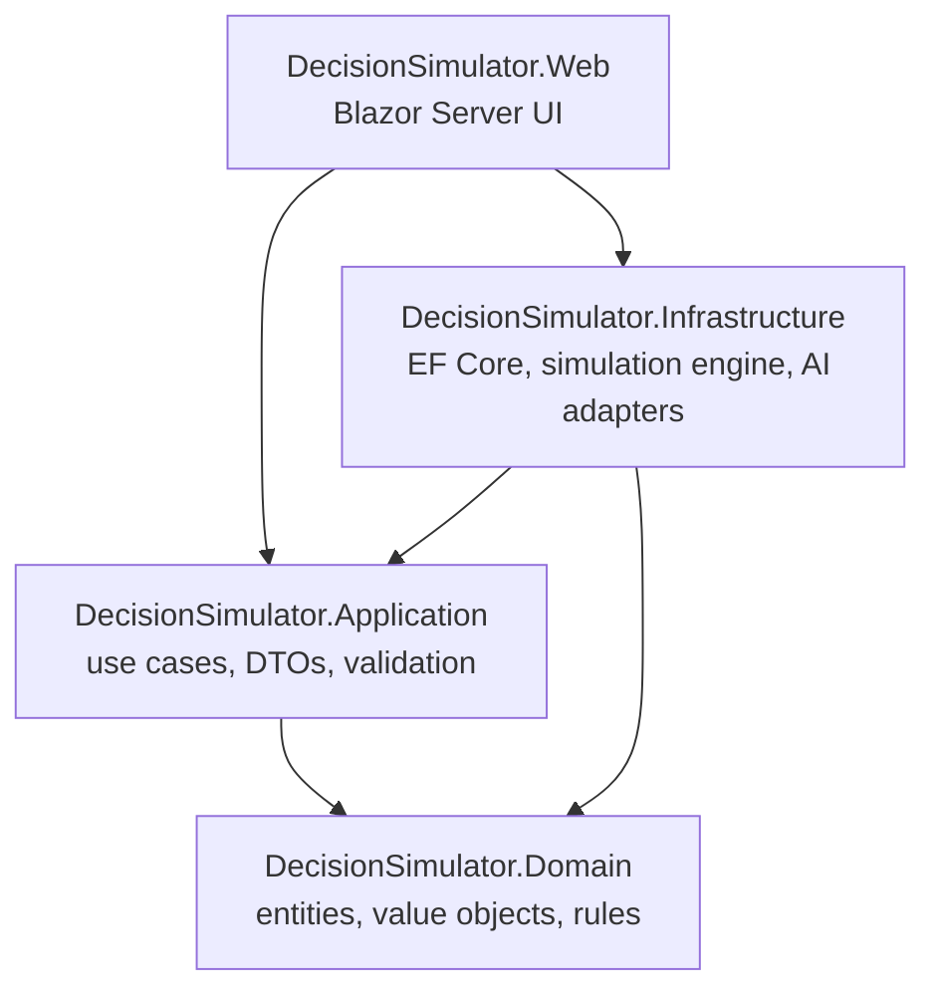

# Personal Decision Simulator

An AI-assisted personal scenario modeling and decision intelligence platform. It helps one person
think through a real decision by making the assumptions explicit, running them forward over time,
and recording what actually happened afterwards.

The tool models possibilities. It does not predict the future.

---

## Table of contents

- [What it does](#what-it-does)
- [Design principles](#design-principles)
- [Feature overview](#feature-overview)
- [Architecture](#architecture)
- [Technology stack](#technology-stack)
- [Getting started](#getting-started)
- [Configuration](#configuration)
- [Sample data](#sample-data)
- [Localization](#localization)
- [The simulation engine](#the-simulation-engine)
- [The AI assistant](#the-ai-assistant)
- [Testing](#testing)
- [Project layout](#project-layout)
- [Documentation](#documentation)
- [Known limitations](#known-limitations)

---

## What it does

A decision is a question you can still change your mind about. The application treats it that way:

1. **Record the decision.** A title, a category, how much it matters, and the horizon over which it
   plays out.
2. **Model the alternatives.** Every decision needs at least two, because a decision with one path
   is not a decision.
3. **Write scenarios.** A scenario is a set of assumptions you are willing to take seriously. Each
   assumption is a variable with a distribution, a unit, and a stated basis.
4. **Run the simulation.** The engine samples the assumptions and projects the outcome month by
   month, producing a range rather than a single number.
5. **Compare and decide.** Alternatives are ranked against the scenarios, with the downside shown
   as prominently as the upside.
6. **Review what happened.** A review records the real outcome, which is the only way to learn
   whether the model was useful.

## Design principles

These are enforced in code, not just documented.

| Principle | How it is enforced |
| --- | --- |
| Never present an assumption as an observation | `DistributionBasis` distinguishes `Empirical` from `Exploratory` and `UserDefined`; the UI labels them differently |
| Every number carries its provenance | `DataObservation` stores source, observation date, confidence, and verification state |
| Stale data is visible, not hidden | Indicators compute a freshness state and the UI shows it |
| The AI never invents numbers | The assistant proposes text and structure; numeric values must come from the user or a data source |
| The AI never changes data without consent | Proposals are stored as `AIProposal` records and applied only on explicit confirmation |
| Secrets never enter the database | `SettingKeys.SecretKeys` is rejected by the settings service; API keys come from configuration |
| A missing translation is a build error | `AppStrings` members are `required`, so an incomplete catalogue does not compile |

## Feature overview

**Decisions** — create, categorize, and track a decision through its lifecycle: exploring, modeling,
evaluating, decided, monitoring, reviewed. Each decision holds alternatives, scenarios, documents,
and reviews.

**Scenarios** — assumptions bound to a shared variable catalogue, with distributions, units, and an
explicit basis. Scenarios can declare dependencies on other scenarios.

**Simulations** — a deterministic, seeded Monte Carlo engine. The same seed and the same inputs
always produce the same output, which makes a result reproducible and reviewable.

**Risks** — risk factors with likelihood, impact, and mitigation, linked to the decisions and
scenarios they affect.

**Data** — data sources, economic indicators, and observations. Each observation records where the
number came from, when it was observed, and how much it should be trusted.

**Assistant** — an optional language-model assistant. It ships with a `None` provider that works
fully offline, plus configurable OpenAI-compatible and Ollama adapters.

**Documents** — attachments stored on the local filesystem with a size limit and a recorded
checksum.

**Audit** — an append-only log of the changes that matter.

**Settings** — a user profile (location, language, calendar, currency) and non-secret application
settings.

## Architecture

A modular monolith following Clean Architecture. Dependencies point inward only.



- **Domain** has no dependencies. Entities own their invariants and expose behaviour rather than
  public setters, so an invalid state cannot be constructed.
- **Application** defines the use cases and the `IApplicationDbContext` abstraction. It never
  references EF Core.
- **Infrastructure** implements persistence, the simulation engine, document storage, and the AI
  providers.
- **Web** is a Blazor Server application. It composes the layers and contains no business rules.

The simulation engine is reached through `ISimulationEngine`, so the application layer does not
depend on the implementation.

## Technology stack

| Area | Choice |
| --- | --- |
| Runtime | .NET 9.0 |
| UI | Blazor Server (interactive server render mode) |
| Data access | EF Core 9.0 with SQL Server |
| Logging | Serilog (console plus a rolling file) |
| Testing | xUnit, EF Core InMemory and SQLite providers |
| Analysis | .NET analyzers at `latest-recommended` |

## Getting started

### Prerequisites

- .NET 9 SDK
- SQL Server 2019 or later (Developer or Express is sufficient), or an existing instance you can
  reach
- The `dotnet-ef` tool if you intend to manage migrations: `dotnet tool install --global dotnet-ef`

### Steps

```powershell
# 1. Restore
dotnet restore PersonalDecisionSimulator.sln

# 2. Point the app at your SQL Server instance.
#    Edit src/DecisionSimulator.Web/appsettings.json, or set an environment variable:
$env:ConnectionStrings__Default = "Server=localhost;Database=PersonalDecisionSimulator;Trusted_Connection=True;TrustServerCertificate=True;MultipleActiveResultSets=True"

# 3. Create the database schema
dotnet ef database update `
  --project src/DecisionSimulator.Infrastructure `
  --startup-project src/DecisionSimulator.Web

# 4. Run
dotnet run --project src/DecisionSimulator.Web
```

The application listens on the URL printed at startup. Open it in a browser.

On first start the app installs the built-in variable catalogue and, if the database is empty, a set
of sample decisions. Both steps are additive and safe to repeat.

### Health check

`GET /health` reports whether the database is reachable. It is the quickest way to tell "the app is
broken" from "the database is down".

```json
{ "status": "ok", "database": "reachable" }
```

## Configuration

Configuration lives in `src/DecisionSimulator.Web/appsettings.json`. Every value can be overridden
by an environment variable using the standard `Section__Key` form.

| Key | Purpose | Default |
| --- | --- | --- |
| `ConnectionStrings:Default` | SQL Server connection string | local instance, Windows auth |
| `AI:Provider` | `None`, `OpenAICompatible`, or `Ollama` | `None` |
| `AI:BaseUrl` | Endpoint for a remote provider | empty |
| `AI:ApiKey` | Credential for a remote provider | empty |
| `AI:Model` | Model name | empty |
| `AI:TimeoutSeconds` | Request timeout | `60` |
| `AI:AllowRemoteProviders` | Master switch for outbound calls | `false` |
| `AI:MaxRemoteSensitivity` | Highest data sensitivity allowed to leave the machine | `Internal` |
| `DocumentStorage:RootPath` | Where attachments are written | `App_Data/documents` |
| `DocumentStorage:MaxFileSizeBytes` | Upload limit | `26214400` (25 MB) |

### Secrets

An API key is never written to the database. The settings page rejects keys listed in
`SettingKeys.SecretKeys`, because anything in that table would be copied into every backup. Supply
the key through configuration or an environment variable instead:

```powershell
$env:AI__ApiKey = "YOUR_API_KEY"
```

## Sample data

`DemoDataSeeder` installs a small, realistic data set so the application is not empty on first run.
It is deliberately conservative:

- It runs **only when the `Decisions` table is empty**, so it never mixes sample rows into real
  work.
- It runs **only once**, guarded by the `demo.data.seeded` application setting.
- It runs **after** the variable catalogue, because the sample scenarios bind to catalogue keys.

What it creates:

| Item | Count | Notes |
| --- | --- | --- |
| User profile | 1 | Persian, Tehran, Jalali calendar, IRR in Toman |
| Application settings | 5 | Non-secret display and AI defaults |
| Tags | 5 | خانواده, مالی, شغلی, بلندمدت, نیازمند داده |
| Data sources | 3 | Central Bank of Iran, Statistical Center of Iran, personal observations |
| Economic indicators | 4 | CPI year-on-year, free-market USD rate, urban rent index, unemployment |
| Risk factors | 6 | Currency controls, inflation, rent, labour market, connectivity, family support |
| Decisions | 4 | Relocation, online business, housing, job offer |

Every sample decision carries two alternatives and two scenarios, and every assumption is marked
`Exploratory` or `UserDefined` — never `Empirical` — so the interface never presents a guess as a
measurement.

To start over with a clean sample set:

```sql
DELETE FROM Decisions;                       -- cascades to alternatives, scenarios, variables
DELETE FROM AppSettings WHERE [Key] = 'demo.data.seeded';
```

The seeder reinstalls the sample data on the next start.

## Localization

The interface ships in Persian (default, right-to-left) and English (left-to-right).

- `AppStrings` is a strongly-typed catalogue whose members are `required`. A missing translation is
  a compile error rather than a blank label at runtime.
- `LanguageService` resolves the active language from `UserProfile.PreferredLanguage` once per
  request scope and caches it. Concurrent callers are serialised, because a `DbContext` cannot run
  two queries at once.
- The choice is stored on the profile rather than in a cookie, so it survives a cleared browser and
  travels with a backup.
- Switching language forces a full browser reload. Every component then renders from one catalogue,
  which avoids the half-translated screens a partial re-render would produce.
- Enum labels are translated separately through `EnumLabels.Label<TEnum>(value, persian)`.

To add a language, add an `AppStrings` instance and extend `LanguageService.IsSupported` and
`Normalize`. The compiler will list every member you still need to translate.

## The simulation engine

The engine is a seeded Monte Carlo projection.

- **Deterministic.** The same seed and the same inputs always produce the same output, so a result
  can be reproduced and reviewed later.
- **Distribution-aware.** Each variable declares a distribution and a basis. The engine samples
  from it rather than substituting a point estimate.
- **Time-stepped.** Results are produced per month across the scenario horizon, so the shape of the
  outcome over time is visible, not just the endpoint.
- **Range-first.** Output is a distribution of outcomes. The interface shows percentiles and the
  downside, not a single confident number.

## The AI assistant

The assistant is optional and off by default.

- The `None` provider is deterministic and fully offline. Every other part of the application works
  without a language model.
- Remote providers are opt-in twice: `AI:AllowRemoteProviders` must be true **and** the data
  sensitivity must not exceed `AI:MaxRemoteSensitivity`.
- The assistant proposes; it does not act. A proposal is stored as an `AIProposal` and applied only
  when the user confirms it.
- The assistant does not invent numeric values. Numbers come from the user or from a data source
  with a recorded provenance.

## Testing

```powershell
dotnet test PersonalDecisionSimulator.sln
```

| Project | Scope | Tests |
| --- | --- | --- |
| `DecisionSimulator.UnitTests` | Domain rules, application services, validation | 201 |
| `DecisionSimulator.SimulationTests` | Engine determinism, distributions, projections | 121 |
| `DecisionSimulator.IntegrationTests` | Persistence, migrations, end-to-end use cases | 45 |

The build runs the .NET analyzers at `latest-recommended` and the codebase builds with zero
warnings, so a clean build is part of the test signal.

## Project layout

```
PersonalDecisionSimulator/
├── src/
│   ├── DecisionSimulator.Domain/           entities, value objects, enums, domain rules
│   ├── DecisionSimulator.Application/      use cases, DTOs, abstractions
│   │   └── Features/                       AI, Audit, Data, Decisions, Documents,
│   │                                       Risks, Scenarios, Settings, Simulations,
│   │                                       Tags, Variables
│   ├── DecisionSimulator.Infrastructure/   EF Core, migrations, simulation engine,
│   │                                       AI adapters, document storage, seeders
│   └── DecisionSimulator.Web/              Blazor Server UI
│       ├── Components/Pages/               Home, Decisions, DecisionDetail, Scenarios,
│       │                                   ScenarioDetail, Simulations, Risks, Data,
│       │                                   Assistant, Settings
│       ├── Localization/                   AppStrings, LanguageService, EnumLabels
│       └── Services/                       display formatting, preferences access
├── tests/
│   ├── DecisionSimulator.UnitTests/
│   ├── DecisionSimulator.SimulationTests/
│   └── DecisionSimulator.IntegrationTests/
├── scripts/setup-solution.ps1
├── Directory.Build.props
├── NuGet.config
└── PersonalDecisionSimulator.sln
```

## Documentation

| Document | Contents |
| --- | --- |
| [docs/architecture.md](docs/architecture.md) | Layers, dependency rules, and the reasoning behind them |
| [docs/domain-model.md](docs/domain-model.md) | Entities, relationships, and invariants |
| [docs/simulation-engine.md](docs/simulation-engine.md) | How a projection is computed and why it is deterministic |
| [docs/data-and-provenance.md](docs/data-and-provenance.md) | Sources, observations, freshness, and confidence |
| [docs/ai-assistant.md](docs/ai-assistant.md) | Providers, consent, proposals, and the offline default |
| [docs/localization.md](docs/localization.md) | The catalogue, the language service, and adding a language |
| [docs/development.md](docs/development.md) | Build, test, migrate, and troubleshoot |
| [docs/security.md](docs/security.md) | Secrets, remote calls, uploads, and data exposure |

## Known limitations

- **Single user.** The application models one person's decisions. There is no multi-tenancy and no
  authentication layer; it is intended to run on a machine you control.
- **SQL Server only.** The persistence layer targets SQL Server. The test projects use InMemory and
  SQLite, but the production provider is SQL Server.
- **No forecasting.** The engine projects the consequences of the assumptions you supply. It does
  not estimate what those assumptions should be.
- **Sample data is illustrative.** The seeded indicator values are plausible placeholders, not
  current statistics. Replace them with sourced observations before relying on them.
