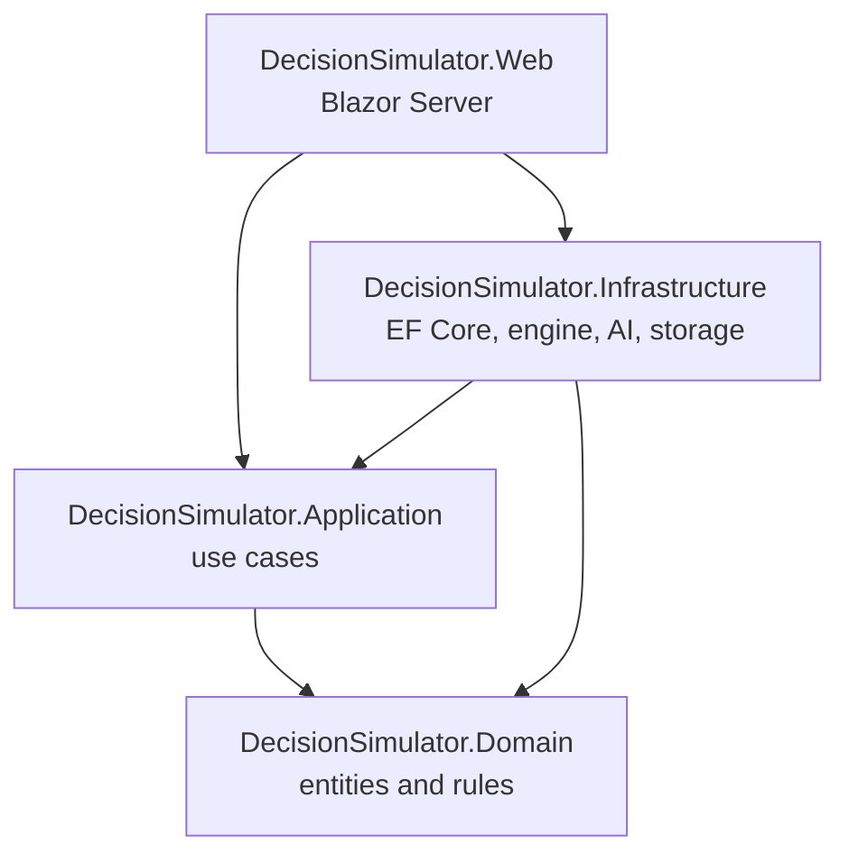
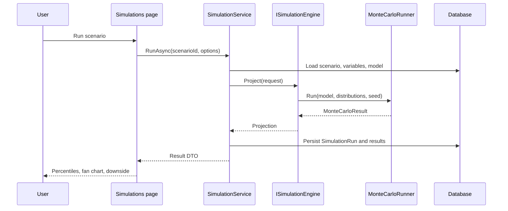

# Architecture

## Shape

A modular monolith following Clean Architecture. One deployable unit, four projects, dependencies
pointing inward only.



`Web` references `Infrastructure` only to compose the container at startup. No page contains a
business rule; pages call application services and render the result.

## Why a modular monolith

The domain is one person's decision-making. The entities are tightly related — a decision owns
alternatives, scenarios, simulations, risks, and reviews, and a scenario binds to a shared variable
catalogue. Splitting that across services would add network boundaries and distributed transactions
without removing any real coupling.

The modularity is expressed through the `Features` folders in the application layer. Each feature
owns its requests, DTOs, and service. A feature may call another feature's service, but it never
reaches into another feature's internals.

## Layers

### Domain

No dependencies at all. Contains entities, value objects, enums, and domain exceptions.

Entities own their invariants. State changes go through methods that validate, not through public
setters, so an invalid entity cannot be constructed:

```csharp
decision.AdvanceTo(DecisionStatus.Modeling);   // validates the transition
scenario.AddVariable(variable);                // rejects a duplicate key
```

This is why the application layer can trust what it reads from the database.

### Application

Defines the use cases. Depends on Domain only.

- `IApplicationDbContext` is the persistence abstraction. The application layer never references
  EF Core, so it can be tested against an in-memory provider without a database.
- Each feature exposes a service with methods that return a result object rather than throwing for
  expected failures. A validation failure is a value, not an exception.
- Requests and DTOs are records. They are the boundary; entities never cross it.

### Infrastructure

Implements the abstractions. Depends on Application and Domain.

| Folder | Responsibility |
| --- | --- |
| `Persistence` | `DecisionSimulatorDbContext`, configurations, migrations, seeders |
| `Simulation` | Monte Carlo runner, distributions, models, sensitivity, stress testing |
| `AI` | Provider adapters and the router |
| `Storage` | Local document storage |

### Web

Blazor Server. Composes the container, hosts the pages, and formats values for display.

- `Localization` holds the string catalogue and the language service.
- `Services` holds display formatting and the preferences accessor.
- `Components/Pages` holds one component per screen.

## Cross-cutting decisions

### The simulation engine is behind an interface

`ISimulationEngine` lives in the application layer. `SimulationEngineAdapter` implements it in
Infrastructure. The application layer can therefore request a projection without knowing whether it
is computed in-process or elsewhere.

### The database context is exposed narrowly

`DecisionSimulatorDbContext` is registered by `AddPersistence`. The application layer sees it only
as `IApplicationDbContext`:

```csharp
builder.Services.AddScoped<IApplicationDbContext>(provider =>
    provider.GetRequiredService<DecisionSimulatorDbContext>());
```

A feature cannot call `Database.ExecuteSqlRaw` or reach a provider-specific API, because the
interface does not expose one.

### Logging uses source-generated delegates

The analyzers enforce CA1848, so every log call goes through a `[LoggerMessage]` delegate:

```csharp
[LoggerMessage(EventId = 2001, Level = LogLevel.Information,
    Message = "Seeded the sample decisions, scenarios, risks and indicators.")]
public static partial void DemoSeedCompleted(ILogger logger);
```

This avoids boxing and string formatting on the hot path, and it keeps event IDs in one place.

### Startup work never blocks the app

Two seeders run at startup, each in its own try/catch. A failure is logged and startup continues:

- `BuiltInDataSeeder` installs the variable catalogue. Without it the built-in models have no
  variables to bind to, but the user can still create definitions by hand.
- `DemoDataSeeder` installs sample data. It is a convenience, so a failure must not stop the app.

Failing to start would be worse than starting degraded.

### Interactive render mode is declared once

`App.razor` declares `@rendermode="InteractiveServer"` on `<Routes />`. Every screen posts forms and
handles clicks, so the whole tree must be interactive. Declaring it per page would be easy to forget
and would silently produce a page whose handlers never run.

## Data flow

A simulation run, end to end:



The seed is stored with the run, so the same result can be reproduced later.

## Testing strategy

| Project | What it proves |
| --- | --- |
| `UnitTests` | Domain invariants hold; application services validate and return the right result |
| `SimulationTests` | The engine is deterministic; distributions have the right moments; projections behave |
| `IntegrationTests` | Persistence works against a real provider; migrations apply; use cases run end to end |

The unit and simulation projects use EF Core InMemory and SQLite. The integration project exercises
the real configuration.

## Constraints worth knowing

- **Analyzers are on.** `Directory.Build.props` sets `EnableNETAnalyzers` and
  `AnalysisLevel=latest-recommended`. The codebase builds with zero warnings, and keeping it that
  way is part of the review standard.
- **Migrations are excluded from coverage.** They are generated code.
- **`InvariantGlobalization` is false.** The app formats Jalali dates and Persian digits, which
  requires real culture data.
