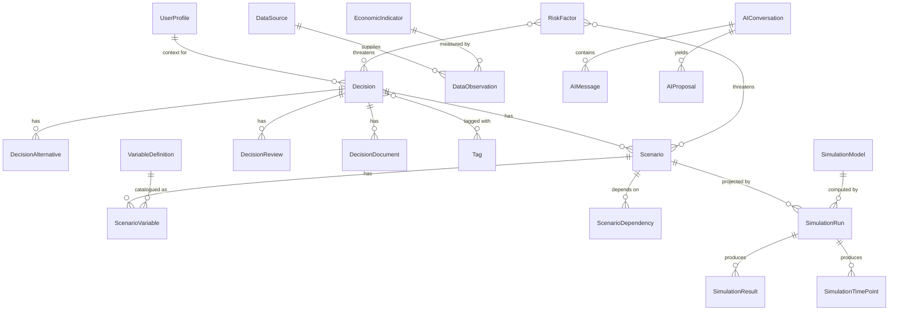
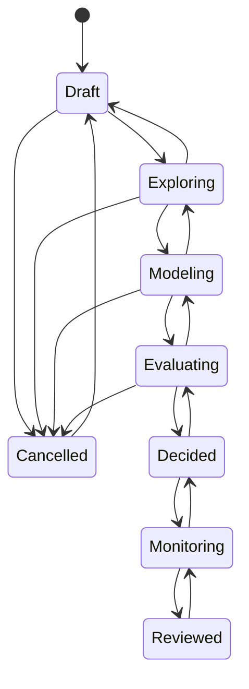

# Domain model

## Overview

The domain is one person's decision-making. A **decision** owns **alternatives**, **scenarios**,
**documents**, and **reviews**. A scenario owns **variables** that bind to a shared **variable
catalogue**. A **simulation run** records the result of projecting a scenario.

## Entities

### Decision

The aggregate root. Everything about one question you can still change your mind about.

| Field | Meaning |
| --- | --- |
| `Title` | The question, phrased as a question |
| `Category` | Career, financial, housing, relocation, and so on |
| `Status` | Where it is in its lifecycle |
| `Importance` | Low, medium, high, critical |
| `Horizon` | Short, medium, long, very long term |
| `RiskTolerance` | How much downside the person accepts |
| `DecisionDate` | When the decision was made |
| `TargetDecisionDate` | When it must be made by |
| `Context`, `DesiredOutcome`, `ConstraintsJson` | The framing, in the person's own words |
| `ReviewScheduledForUtc` | When to check what actually happened |
| `RowVersion` | Optimistic concurrency token |

**Invariants enforced by the entity:**

- A decision has at most one baseline alternative. Adding a second throws.
- A scenario may only reference an alternative that belongs to the same decision.
- A parent scenario must belong to the same decision.
- Status transitions are validated. A cancelled decision cannot silently return to modeling.

**Lifecycle:**

The transitions are deliberately reversible up to the point of decision. Thinking is iterative, and
the model should not punish a person for going back.

### DecisionAlternative

One path the person could take. Carries an estimated initial cost, an estimated recurring cost,
expected benefits, and known risks.

Exactly one alternative may be marked `IsBaseline`. The baseline is the "do nothing" or "stay as I
am" path, and it is what the other alternatives are compared against.

### Scenario

A set of assumptions the person is willing to take seriously.

| Field | Meaning |
| --- | --- |
| `Type` | Baseline, expected, optimistic, pessimistic, stress test, custom |
| `TimeHorizonMonths` | How far forward the projection runs |
| `AlternativeId` | Which alternative this scenario describes, if any |
| `ParentScenarioId` | The scenario this one varies, if any |

A scenario is not a prediction. It is a coherent story about how things could go, expressed as
numbers the engine can project.

### ScenarioVariable

One assumption inside a scenario.

| Field | Meaning |
| --- | --- |
| `VariableKey` | Binds to a `VariableDefinition` |
| `DistributionType` | Fixed, uniform, normal, log-normal, triangular, discrete |
| `Minimum`, `Maximum`, `Mode`, `Mean`, `StandardDeviation` | Distribution parameters |
| `Unit` | What the number is measured in |
| `Basis` | `Empirical`, `Exploratory`, or `UserDefined` |

`Basis` is the most important field in the model. It records whether a number came from measurement
or from the person's judgement, and the interface presents the two differently. A guess is never
shown as a measurement.

### ScenarioDependency

Records that one scenario's variable depends on another scenario's variable, with a correlation
coefficient. The engine uses this to draw correlated samples, so two assumptions that move together
do not get sampled independently.

### SimulationModel

A named, versioned projection model. The version is stored with every run, so a result can be
interpreted against the model that produced it.

### SimulationRun

One execution of a model against a scenario.

| Field | Meaning |
| --- | --- |
| `Seed` | The random seed, stored so the run is reproducible |
| `Iterations` | How many paths were sampled |
| `ModelKey`, `ModelVersion` | Which model produced this |
| `Status` | Pending, running, completed, failed |

### SimulationResult and SimulationTimePoint

`SimulationResult` holds the distribution of a metric across all paths: mean, standard deviation,
and percentiles. `SimulationTimePoint` holds the same per month, which is what the fan chart draws.

### RiskFactor

Something that could go wrong, with a likelihood, an impact, and a mitigation. Linked to the
decisions and scenarios it threatens.

### DataSource

Where a number came from: a provider kind (manual, CSV, JSON, REST, web research), a reliability
rating, an update cadence, and whether it is currently active.

### EconomicIndicator

A named, coded measurement — for example `IR.CPI.YOY` for year-on-year inflation in Iran. Carries a
category, a country, a geographic scope, and a unit.

### DataObservation

One reading of an indicator.

| Field | Meaning |
| --- | --- |
| `Value` | The number |
| `ObservationDate` | When it was true |
| `SourceId` | Where it came from |
| `Confidence` | Unknown, low, medium, high, authoritative |
| `IsVerified` | Whether a human checked it |

Freshness is computed from `ObservationDate`, not stored. A reading does not become stale because
someone forgot to update a flag; it becomes stale because time passed.

### VariableDefinition

The shared catalogue of variable keys. Built-in models bind to keys such as `monthly_income`, so a
definition must exist before a user can enter that assumption. The catalogue is seeded at startup
and is additive: it never overwrites a definition the user has edited.

### UserProfile

The person. Display name, location, time zone, preferred language, calendar system, currency code,
and currency unit convention.

The preferred language lives here rather than in a cookie, so it survives a cleared browser and
travels with a backup.

### AI entities

| Entity | Purpose |
| --- | --- |
| `AIConversation` | A thread, scoped to a decision, scenario, or run |
| `AIMessage` | One turn, with its role and content |
| `AIProposal` | A structured change the assistant suggests, applied only on confirmation |
| `AIExecutionLog` | What was sent, to which provider, and what came back |
| `AIMemory` | Facts the assistant may reuse across conversations |

`AIProposal` is the consent boundary. The assistant can suggest a new scenario or a revised
assumption, but the suggestion is inert until the user accepts it.

### Supporting entities

| Entity | Purpose |
| --- | --- |
| `Tag` | A free-form label with a colour, for grouping decisions |
| `DecisionDocument` | An attachment with a path, content type, size, and checksum |
| `DecisionReview` | What actually happened, compared against what was expected |
| `AssumptionSet` | A named group of assumptions reusable across scenarios |
| `AppSetting` | A non-secret runtime setting |
| `AuditLog` | An append-only record of changes that matter |
| `BackupHistory` | A record of backup operations |

## Value objects

| Type | Purpose |
| --- | --- |
| `GeoLocation` | Country code, country name, city, time zone — validated together |
| `Money` | An amount with a currency code, so a bare decimal cannot be mistaken for the wrong currency |

## Enums

The enums carry meaning the interface must not flatten:

- `DistributionBasis` — `Empirical`, `Exploratory`, `UserDefined`
- `ConfidenceLevel` — `Unknown`, `Low`, `Medium`, `High`, `Authoritative`
- `DecisionStatus` — the lifecycle above
- `ScenarioType` — `Baseline`, `Expected`, `Optimistic`, `Pessimistic`, `StressTest`, `Custom`
- `DistributionType` — `Fixed`, `Uniform`, `Normal`, `LogNormal`, `Triangular`, `Discrete`
- `ImportanceLevel`, `DecisionHorizon`, `RiskTolerance`, `DecisionCategory`
- `VariableCategory`, `GeographicScope`, `DataSourceKind`, `UpdateCadence`

Enum labels are translated separately from the string catalogue, through
`EnumLabels.Label<TEnum>(value, persian)`.

## Base types

| Type | Provides |
| --- | --- |
| `AuditableEntity` | `CreatedAtUtc`, `UpdatedAtUtc`, and a `Touch()` method |
| `IAggregateRoot` | Marks the roots the repositories load |
| `IConcurrencyGuarded` | Exposes `RowVersion` for optimistic concurrency |

## Domain exceptions

| Exception | Raised when |
| --- | --- |
| `DomainException` | A rule is violated |
| `InvalidStateTransitionException` | A status change is not allowed |
| `EntityNotFoundException` | A referenced entity does not exist |

The application layer catches these at the boundary and turns them into a failed result, so a page
never sees an exception for an expected condition.
